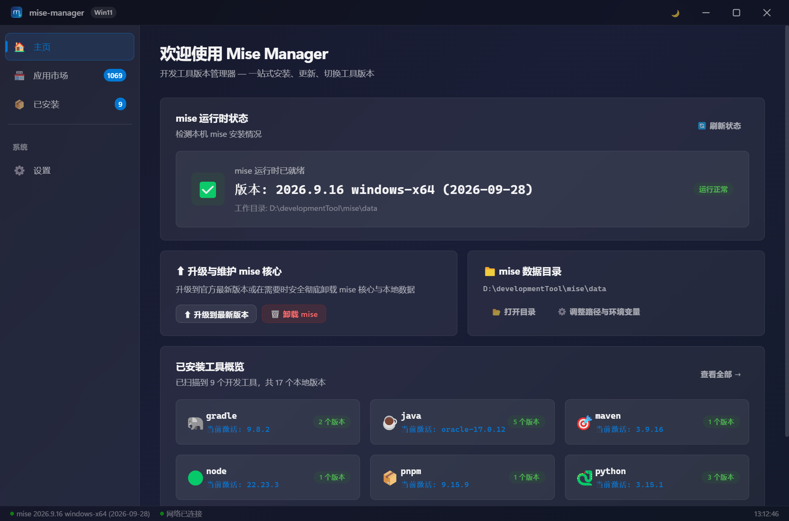
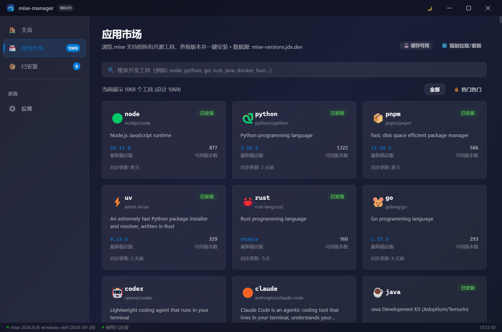
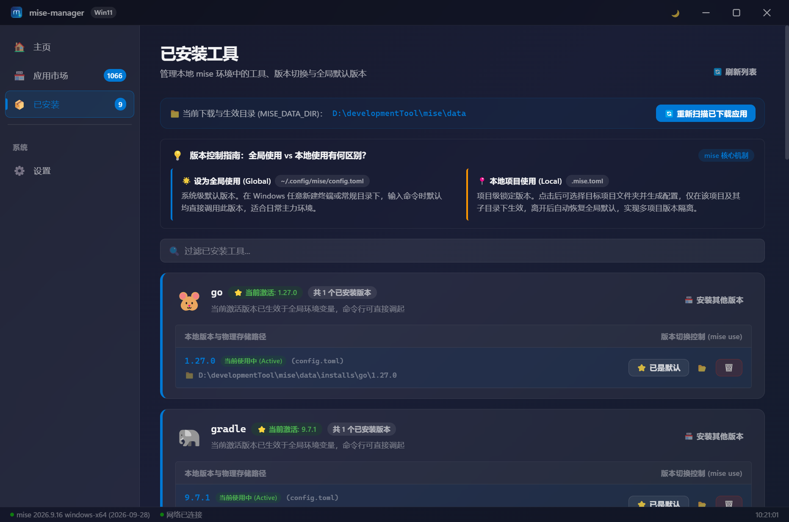
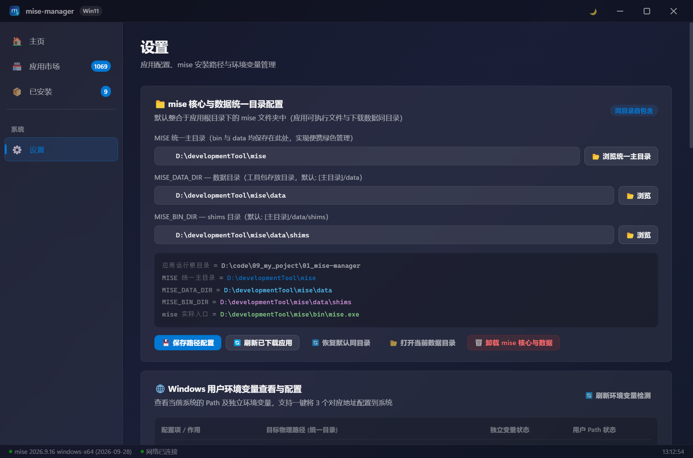
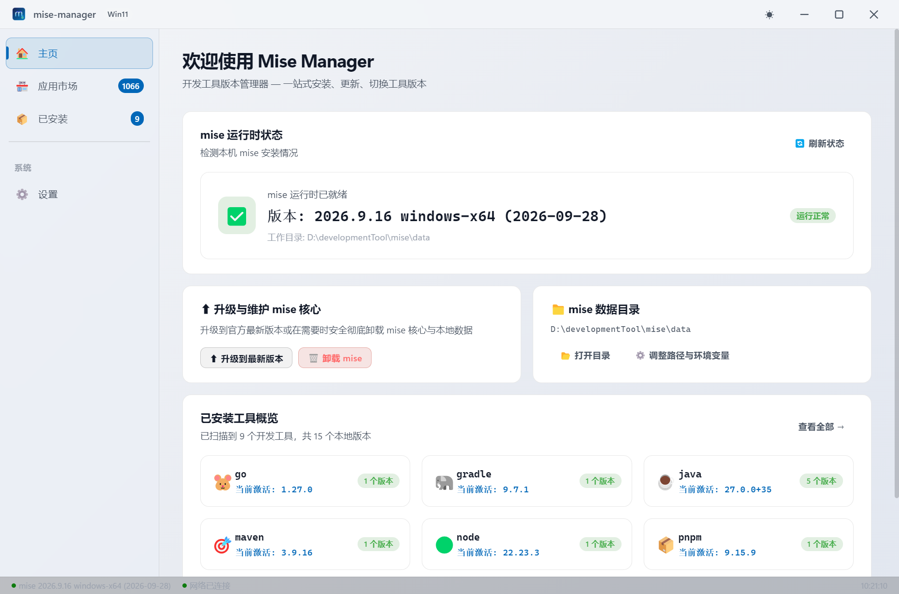
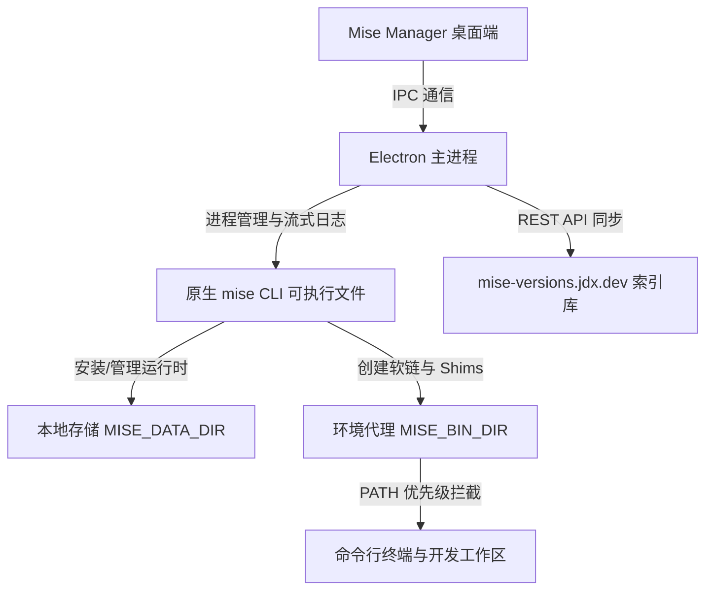

# Mise Manager

<div align="center">


###  mise 桌面版本管理器

一款专为 Windows 平台打造的开发环境与工具版本管理桌面应用，深度契合 Windows 11 Fluent Design 设计语言，为 [mise](https://github.com/jdx/mise) 赋予可视化操作体验。

[](https://github.com/jdx/mise)
[](https://www.electronjs.org/)
[](https://developer.microsoft.com/fluentui)
[](LICENSE)

[功能特性](#-功能特性) • [界面预览](#-界面预览) • [快速开始](#-快速开始) • [常见问题](#-常见问题--faq) • [工作原理](#-工作原理与环境变量) • [致谢与灵感](#-致谢与上游开源项目) • [开源许可](#-开源协议)

</div>

---

## 📖 项目简介

在现代全栈开发中，开发者往往需要在不同的语言版本（如 Node.js 18/20/22、Python 3.10/3.12、Go、Rust、Java、Yarn 等）之间频繁切换。**mise**（前身为 rtx）凭借 Rust 带来的极致性能，成为了开发环境与版本管理领域的标杆工具。

**Mise Manager** 致力于降低 Windows 开发者使用 mise 的门槛，提供了一个极具现代感、无缝融合 Windows 11 视觉质感的图形化控制台。无需记忆繁杂的 CLI 参数，即可在界面中轻松检索全网工具、一键切换版本、监控系统环境变量与维护本地工具链。

---

## 🖼️ 界面预览

### 1. 主页工作台 (Home Dashboard)
直观呈现本机 mise 运行时状态、版本就绪指标、数据存放路径与已安装主流开发工具快速概览。


### 2. 应用生态市场 (Tool Ecosystem Market)
实时对接官方 REST API，全量聚合 1000+ 开源工具生态，支持关键词检索、分类探查、多版本选择与一键静默安装。


### 3. 已安装工具精细化管理 (Installed Tools)
清晰展示已安装语言和运行时的所有物理版本，支持 Global（全局默认）与 Local（项目独立）热切换与物理目录秒级直达。


### 4. 路径配置与环境变量托管 (Settings & Environment)
绿色便携式设计，支持自定义数据目录与 Shims 路径，内置 PowerShell 引擎一键将环境安全写入 Windows 用户环境变量。


### 5. 极速版本发布日志与多主题适配
内置 GitHub Releases 秒级缓存与更新探查弹窗；原生深度适配 Windows 11 Fluent 深色 / 浅色模式无缝切换。

| 历史版本发行与安装包直达 | Fluent 浅色模式界面 |
| :---: | :---: |
|  |  |

---

## ✨ 功能特性

- 🎨 **原生 Windows 11 视觉盛宴**
  - 严格遵循 Fluent Design 设计规范，拥有 Mica（云母）/ 亚克力半透明光效与细腻的微动效。
  - 完美适配系统自定义深色/浅色模式无缝切换与沉浸式无边框标题栏。
- 🏪 **丰富的工具版本生态市场**
  - 对接 [mise-versions](https://github.com/jdx/mise-versions) 官方数据源与 REST API，涵盖数百种主流语言、运行时和 CLI 工具。
  - 支持关键词模糊检索、分类筛选与历史版本探查，一键触发后台安装与版本部署。
- 📦 **已安装工具精细化管理**
  - 集中监控本机所有通过 mise 管理的工具版本状态。
  - 支持一键激活版本（Global / Local）、版本热切换、快速定位本地物理安装目录及安全卸载。
- ⚙️ **灵活的路径与环境变量托管**
  - 自定义 `MISE_DATA_DIR`（数据安装根目录）与 `MISE_BIN_DIR`（Shims 二进制目录），支持便携移动盘与特定盘符部署。
  - 内置环境检测与自动修复，告别繁复的手工编辑系统 PATH 环节。
- ⚡ **轻量与异步响应**
  - 基于 IPC 双向通信与流式子进程管道，安装过程日志实时滚动，杜绝界面假死。

---

## 🚀 快速开始

### 环境依赖

- **操作系统**：Windows 10 / Windows 11（推荐 64 位）
- **Node.js**：`>= 18.0.0`
- **包管理器**：推荐使用 [Yarn](https://yarnpkg.com/) 或 `npm`

### 安装与运行

1. **克隆或拉取仓库源码**：
   ```powershell
   git clone <your-repository-url>
   cd 09_mise-manager
   ```

2. **安装项目依赖**：
   ```powershell
   yarn install
   # 或者使用 npm
   npm install
   ```

3. **启动开发模式**：
   ```powershell
   yarn start
   # 或者使用 npm
   npm run start
   ```

4. **打包构建 Windows 安装包 (NSIS)**：
   ```powershell
   yarn build
   # 构建产物将生成在 dist/ 目录下
   ```

5. **一键生成最新说明文档界面截图**：
   ```powershell
   yarn screenshot
   # 自动化运行并将各页面高保真截图输出至 docs/screenshots/
   ```

---

## 🛠️ 工作原理与环境变量

Mise Manager 充当了桌面可视化层与底层原生执行层之间的桥梁：



- **数据根目录 (`MISE_DATA_DIR`)**：存放所下载的各类语言包与 SDK，默认隔离于用户数据目录中，亦可在设置面板重定向至大容量磁盘。
- **Shims 目录 (`MISE_BIN_DIR`)**：存放垫片执行文件，保证通过系统命令行唤起工具时始终无缝调用所激活的版本。

---

## ❓ 常见问题 (FAQ)

### Q1: 下载新版本安装包，直接覆盖安装就算更新了吗？会不会丢失数据？
**答：是的，直接覆盖安装即可完成完整升级，且绝对不会丢失任何已有数据。**
- **程序文件替换**：安装包（NSIS）具有统一的 `appId`，在安装时会自动检测既有安装路径并更新核心程序；
- **配置与数据隔离**：软件配置位于系统用户目录（`%APPDATA%\mise-manager\`），而下载的各类语言版本（Node.js、Python、Go 等）均安全存放于数据根目录（`MISE_DATA_DIR`），与主程序本体完全解耦，覆盖升级过程安全无痛。

### Q2: 首次在 Windows 10/11 上运行提示“Windows 已保护你的电脑 / 未知发布者”怎么办？
**答：这是未申请昂贵商业代码签名证书的开源软件在 Windows SmartScreen 机制下的正常表现，请放心使用。**
- **秒级放行**：在拦截弹窗中点击 **「更多信息」 (More info)**，紧接着点击右下角浮现的 **「仍要运行」 (Run anyway)** 即可正常打开。系统在初次允许后将记忆授权，后续启动不再提示；
- **备选方案**：鼠标右键点击安装包或 exe -> **「属性」** -> 在常规选项卡右下方勾选 **「解除锁定」 (Unblock)** -> 点击确定。

---

## 🤝 致谢与上游开源项目

本项目深度依托并致敬以下优秀的开源项目与创作者，没有它们在开发工具链领域的卓越贡献，就没有 Mise Manager 的诞生：

- **[mise (by @jdx)](https://github.com/jdx/mise)**
  > *The front-end to your dev environment.*  
  用 Rust 打造的高性能、跨语言开发工具多版本管理器与任务运行器。Mise Manager 的底层运行逻辑与安装能力全部依托于 mise 原生内核。
  - 官方文档：[mise.jdx.dev](https://mise.jdx.dev)
  - GitHub 仓库：[https://github.com/jdx/mise](https://github.com/jdx/mise)

- **[mise-versions (by @jdx)](https://github.com/jdx/mise-versions)**
  > *Index of all tools and versions supported by mise.*  
  mise 官方维护的全量工具生态及其可用版本的元数据索引服务。本项目应用市场中的海量工具清单、版本元数据与检索体验均得益于此项目及其开放的在线接口服务。
  - 在线市场：[mise-versions.jdx.dev](https://mise-versions.jdx.dev)
  - GitHub 仓库：[https://github.com/jdx/mise-versions](https://github.com/jdx/mise-versions)

---

## 📄 开源协议

本项目基于 [MIT 协议](LICENSE) 开源，欢迎提交 Issue 与 Pull Request 共同构建更优质的 Windows 开发者工具生态！
