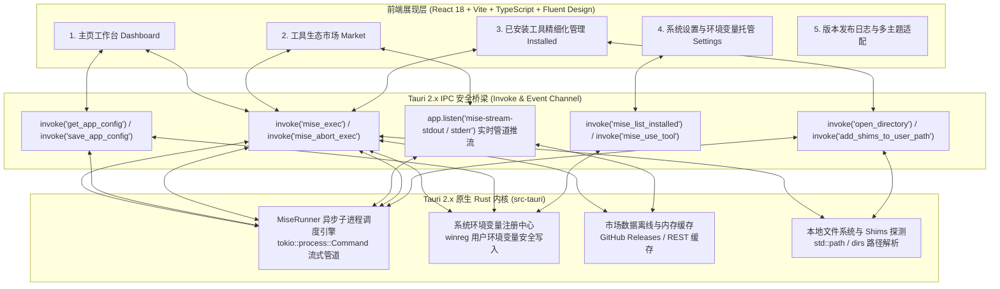

# Mise Manager (mise 桌面版本管理器) - 架构设计与实施方案

## 1. 项目定位与核心价值

**Mise Manager** 是一款专为 Windows 10/11 平台量身打造的开发环境与工具版本管理桌面应用，为 Rust 编写的现代化 CLI 工具 [mise](https://github.com/jdx/mise) 赋予可视化操作能力。
项目采用 **Tauri 2.x + Rust 异步原生底层 + Vite/React 18 + Fluent Design System** 现代桌面架构，深度解决开发者在 Windows 平台下管理多语言版本与工具链的痛点：
- **无门槛交互体验**：彻底告别复杂的 CLI 命令行参数与终端环境变量记忆，实现所见即所得的可视化检索与安装；
- **全生态生态聚合**：实时对接官方 REST 数据源，聚合 1000+ 开源工具生态，支持关键词检索、多版本探查与一键安装；
- **版本秒级热切换**：毫秒级探查已安装语言与版本，支持 Global（全局默认）与 Local（项目独立）热切换与物理目录直达；
- **绿色便携与环境托管**：灵活支持自定义 `MISE_DATA_DIR` 与 `MISE_BIN_DIR`，内置系统注册表引擎一键将 Shims 垫片安全写入 Windows 用户环境变量。

---

## 2. 核心架构拓扑设计



---

## 3. 四大核心业务功能板块

### 板块一：主页仪表盘与就绪态感知 (Home Dashboard)
1. **运行时检测与版本探查**
   - 自动探查本机 `mise.exe` 安装状态、物理路径与最新版本号 (`mise --version`)；
   - 监控系统 PATH 是否已正确纳入 `MISE_DATA_DIR\shims`；
   - 若未就绪，提供一键引导下载与系统环境变量初始化方案。
2. **核心指标概览**
   - 实时聚合展示已激活的全局主流语言（Node.js、Python、Go、Rust、Java、Maven 等）及其版本号；
   - 统计当前工具总数与磁盘占用估算。

---

### 板块二：应用生态市场与自动化部署 (Tool Ecosystem Market)
1. **生态目录聚合与检索**
   - 对接 [mise-versions](https://github.com/jdx/mise-versions) 官方数据源与 REST API，涵盖全量 1000+ 开源工具；
   - 支持多分类标签（Node、Python、Database、CLI 等）快速筛选与全文模糊搜索；
2. **多版本探查与异步静默安装**
   - 点击工具卡片展开版本选择抽屉，支持最新正式版（Latest）、LTS 长期支持版及历史指定版本；
   - 基于 Rust 异步管道实时推送 stdout/stderr 输出日志，安装过程进度实时滚动，界面始终保持 60FPS 流畅交互。

---

### 板块三：已安装工具精细化管理 (Installed Tools Manager)
1. **本地版本多维呈现**
   - 结构化呈现本地磁盘已安装的所有工具与其包含的具体版本列表；
   - 识别当前被标记为 `Global` 默认使用的活跃版本。
2. **版本热切换与物理运维**
   - 一键执行 `mise use -g <tool>@<version>` 切换全局默认版本；
   - 支持一键在 Windows 资源管理器中打开该版本的物理安装目录；
   - 提供安全卸载确认机制，彻底清理无效旧版本释放磁盘空间。

---

### 板块四：路径配置与系统环境变量托管 (Settings & Environment)
1. **绿色路径灵活配置**
   - 支持自由更改 `MISE_DATA_DIR`（数据存放目录）与 `MISE_BIN_DIR`（Shims 目录），完美支持便携移动盘；
2. **Windows 用户环境变量自动化配置**
   - 内置基于 Rust `winreg` 库的安全写入引擎，一键追加或更新 Windows 用户环境变量 `Path` 与 `MISE_DATA_DIR`，杜绝手动修改系统高级设置导致环境变量截断损坏的风险。

---

## 4. 关键技术方案与设计模式

1. **毫秒级本地缓存策略**：
   - 工具市场元数据与 Releases 发行日志采用双级缓存（内存热缓存 + 本地 JSON 持久化），二次进入无感知加载。
2. **Rust 原生注册表安全引擎**：
   - 避免传统脚本反斜杠、空格及中文字符引发的命令注入，采用 Rust 原生 Win32 注册表 API 原子安全写入。
3. **流式管道与非阻塞事件总线**：
   - 使用 Tokio 异步管道建立流式通道，分批向前端 WebView2 推送实时编译日志，彻底告别旧架构假死卡顿。

---

## 5. 工程目录结构规范

```
01_mise-manager/
├── README.md                   # 项目图文说明文档
├── CHANGELOG.md                # 版本发布与演进记录
├── package.json                # 项目依赖与前端构建脚本
├── vite.config.ts              # Vite 构建配置
├── src/                        # 前端 React 18 + TypeScript 源代码
│   ├── App.tsx                 # 根组件与路由调度
│   ├── main.tsx                # 应用启动入口
│   ├── components/             # Fluent 基础组件与抽屉终端
│   ├── pages/                  # 业务页面 (home, market, installed, settings)
│   ├── services/               # Tauri invoke 与 API 抽象服务层
│   ├── styles/                 # Fluent Design 亚克力与主题 CSS
│   └── types/                  # TypeScript 类型定义
├── src-tauri/                  # Tauri 2.x 原生 Rust 内核
│   ├── Cargo.toml              # Rust 依赖声明
│   ├── tauri.conf.json         # Tauri 桌面窗口与打包配置
│   ├── tauri.offline.conf.json # 离线内嵌 WebView2 打包配置
│   └── src/                    # Rust 业务源码 (commands, mise, tray, lib)
├── doc/                        # 架构设计方案与导航
├── docs/                       # 详细工程规范与设计说明书 (SRS, HLD, DLD, 测试计划等)
├── 启动热更新开发环境.bat      # 本地极速开发热更新调试脚本
└── 启动桌面客户端.bat          # 本地桌面客户端启动脚本
```
