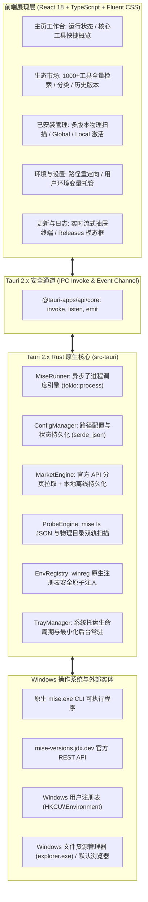
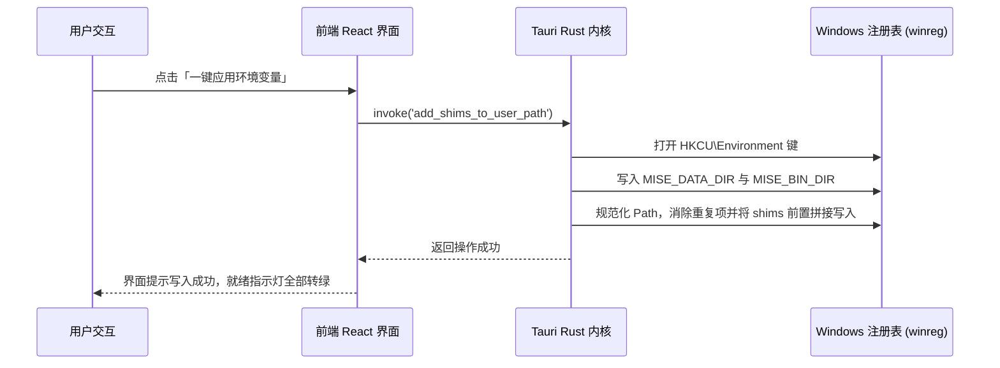

# 02 概要设计说明书（HLD）

| 项目 | 内容 |
| --- | --- |
| 产品名称 | Mise Manager — Windows 11 Fluent 风格 mise 版本管理器桌面应用 |
| 文档版本 | v2.0（Tauri 2.x + Rust 原生重构归档） |
| 依据基准 | 《01 需求规格说明书》v2.0 |
| 目标架构 | Tauri 2.x + Rust 2021 + React 18 + Fluent Design + Windows 原生注册表 |

---

## 1. 架构目标与设计原则

| 原则 | 落地实施策略 |
| --- | --- |
| **极致轻量与瞬时冷启** | 告别传统 Electron 厚重运行时，底层由 Rust 原生编译并依托系统 WebView2，安装包仅 ~4MB，常驻内存仅 ~35MB，启动耗时仅需百毫秒。 |
| **绿色隔离与安全解耦** | 应用主程序与下载的 SDK/运行时绝对解耦。默认统一收敛于 `[应用目录]\mise`，用户可任意重定向至大容量磁盘，覆盖安装绝不丢失任何数据。 |
| **非阻塞与流式响应** | 长时间运行的 CLI 安装或构建任务通过 Rust Tokio 异步子进程管理，并通过 Tauri 事件管道（`mise-stream-stdout / stderr`）实时推流，输出毫秒级滚动。 |
| **双轨探测与零故障降级** | 工具扫描采用 `mise ls --json` 与直接扫描 `data/installs` 物理目录双轨并行机制，当 CLI 命令偶发超时，物理扫描无缝接管，杜绝假死。 |
| **原生注册表安全写入** | 系统环境写入由 Rust 底层 `winreg` 库直接调用 Win32 注册表 API 原子操作，仅作用于用户级环境变量（User PATH），安全防截断。 |
| **Win11 原生质感** | 深度调用 Windows 11 的 Mica（云母）/ 亚克力背景材质，结合纯 CSS 变量实现的深浅模式，带来原生操作系统级的使用质感。 |

---

## 2. 技术选型与技术栈清单

### 2.1 框架与运行时选型

| 评估维度 | Tauri 2.x + Rust（当前选型） | 原 Electron 32 方案 | 纯原生 C# WinUI 3 |
| --- | --- | --- | --- |
| **资源与内存开销** | **极低 (~35MB RAM)**，零 Chromium 内存负担 | 极重 (140MB ~ 180MB RAM) | 较低 (~50MB RAM) |
| **安装包体积** | **极轻 (~4MB 标准版)** | 庞大 (80MB ~ 100MB) | 较大 (依赖 Windows SDK) |
| **冷启动性能** | **百毫秒瞬时直出 (<200ms)** | 秒级延迟 (1.8s ~ 2.5s) | 较快 (~400ms) |
| **底层管道控制** | 基于 Rust Tokio 异步多线程管道，原生高吞吐 | 基于 Node.js `child_process`，开销较大 | 基于 Win32 P/Invoke，代码繁琐 |
| **UI 自由度与美学** | 现代 React 18 + Fluent Design，深度契合 Windows 11 | Web 技术支持，但受制于宿主框架 | 控件样式受限，暗黑模式调整繁琐 |
| **结论** | **当前终极最优解**：完美兼顾原生极致性能、安全类型契约与现代桌面视觉美学。 |

### 2.2 技术栈全景清单

| 层次 | 模块 / 依赖 | 版本 | 核心用途 |
| --- | --- | --- | --- |
| **桌面框架** | Tauri 2.x | `^2.0.0` | 跨平台轻量桌面核心、窗口管理、系统托盘、原生安全沙盒 |
| **系统底层** | Rust Edition | `2021` | 原生高并发异步运行时、内存安全、无惧数据竞态 |
| **异步引擎** | tokio | `^1.38` | 多任务异步运行时，驱动 `tokio::process::Command` 非阻塞进程管道 |
| **系统注册表** | winreg | `^0.52` | 原子写入 Windows 用户环境变量 `MISE_DATA_DIR` 与 `Path` |
| **前端展现** | React 18 + TypeScript | `^18.3` | 组件化 UI 框架，提供高内聚展示层与严格类型约束 |
| **构建工具** | Vite | `^5.4` | 极速热更新开发服务器与现代化前端生产编译 |
| **样式系统** | Fluent Design (自研 CSS) | 规范 | 自适应深浅色主题、Mica 半透明、亚克力磨砂、微动效 |
| **质量守门员** | 架构量化检查器 | 自研 | 严守单文件 `<= 500` 行、单函数 `<= 50` 行、禁用原生弹窗红线 |

---

## 3. 总体分层架构拓扑

---

## 4. 关键设计机制与核心流程

### 4.1 绿色运行目录规划与解耦

- **环境变量优先级前置**：在 Rust 构造执行环境时，强制将 `miseBinDir`（shims）与 `miseExeDir`（bin）置于系统 `PATH` 最前列，确保调用的工具版本准确无误。

### 4.2 Rust 异步管道推流与安全中止

1. **流式推流**：在 `MiseRunner` 中使用 `tokio::process::Command` 启动子进程，通过异步读取 stdout/stderr 管道，使用 `app_handle.emit("mise-stream-stdout", line)` 毫秒级推送到前端抽屉终端；
2. **安全中断**：若用户中途点击“取消/中止”，Rust 端通过保存的子进程引用安全 kill 进程树，杜绝 Windows 下孤立后台编译进程继续消耗 CPU/内存。

### 4.3 市场全量数据拉取与离线持久化机制

1. **官方接口对接**：分页从官方 API 拉取全量工具索引；
2. **本地缓存**：数据合并后持久化写入本地缓存，支持离线秒开；
3. **极速秒开**：后续进入时直接读取本地缓存（<10ms），保证用户进入应用市场零等待。

### 4.4 Windows 环境变量原子注入流程

---

## 5. 打包构建与分发设计

系统通过 Tauri CLI 在 CI/CD（GitHub Actions `build-artifacts.yml`）与本地构建四大标准化产物：
1. **含 WebView2 离线完整版 (`mise-manager-setup-__VERSION__-full-offline-x64.exe`)**：内置微软官方离线包，专为无网隔离机房设计，100% 自动静默安装可用；
2. **官方标准安装包 (`mise-manager-setup-__VERSION__-x64.exe`)**：向导式安装，体积轻巧（~4MB），带桌面快捷方式与卸载程序；
3. **单文件免安装便携版 (`mise-manager-portable-__VERSION__-x64.exe`)**：双击即用，不写注册表，U 盘随身携带；
4. **绿色免安装压缩包 (`mise-manager-__VERSION__-win-x64.zip`)**：解压即可直接运行，适合脚本分发与极客定制。

---

## 6. 后续架构升级路线图 (Roadmap)

1. **v2.1 升级**：集成国内镜像源加速切换面板（Npmmirror、清华源、华为源等一键切换）；
2. **v2.2 升级**：支持工作区 `.mise.toml` 文件的可视化表单化编辑与快速模版套用；
3. **v2.3 升级**：增加 WSL2 跨子系统环境互联互通机制，支持在 Windows 桌面端透传管理 WSL 内的 mise 运行时。
