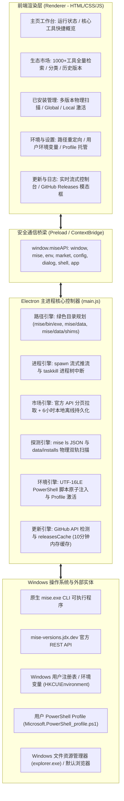
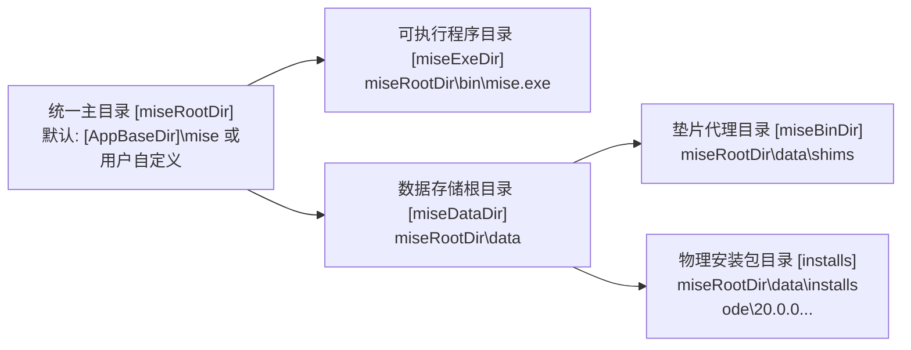
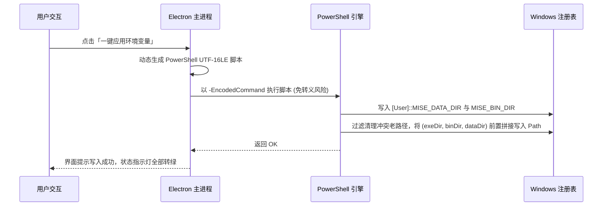

# 02 概要设计说明书（HLD）

| 项目 | 内容 |
| --- | --- |
| 产品名称 | Mise Manager — Windows 11 Fluent 风格 mise 版本管理器桌面应用 |
| 文档版本 | v1.0（正式归档与升级基线） |
| 依据基准 | 《01 需求规格说明书》v1.0 |
| 目标架构 | Electron 32 + Node.js 22 + Fluent Design + 原生 PowerShell 管道 |

---

## 1. 架构目标与设计原则

| 原则 | 落地实施策略 |
| --- | --- |
| **绿色隔离与安全解耦** | 应用主程序与下载的 SDK/运行时绝对解耦。默认统一收敛于 `[应用目录]\mise`，用户可任意重定向至大容量磁盘，覆盖安装绝不丢失任何数据。 |
| **非阻塞与流式响应** | 长时间运行的 CLI 安装或构建任务绝不同步阻塞；主进程与渲染进程通过 IPC 事件管道（`mise:stream`）实时推流，输出实时滚动。 |
| **双轨探测与零故障降级** | 工具扫描采用 `mise ls --json` 与直接扫描 `data/installs` 物理目录双轨并行机制，当 CLI 命令偶发超时，物理扫描无缝接管，杜绝假死。 |
| **系统侵入最小化** | 系统环境写入仅作用于当前用户的用户级环境变量（User PATH），严禁篡改系统级全局配置；支持一键撤销与纯净卸载。 |
| **Win11 原生质感** | 深度调用 Windows 11 的 Mica（云母）背景材质，结合纯 CSS 变量实现的深浅模式，带来原生操作系统级的使用质感。 |

---

## 2. 技术选型与技术栈清单

### 2.1 框架与运行时选型

| 评估维度 | Electron 32 + Node.js（当前选型） | 纯原生 C# WinUI 3 | 传统 Web 浏览器方案 |
| --- | --- | --- | --- |
| **子进程与管道控制** | 深度集成 Node.js `child_process`，管道流、进程树 `taskkill`、信号控制极度成熟 | 需深入调用 Win32 P/Invoke | 无法直接管理本地文件系统与环境变量 |
| **API 与离线缓存处理** | 原生 `net.fetch` 支持流式传输，本地 JSON 缓存读写毫秒级 | 需繁琐的序列化与网络库配置 | 受限于浏览器 Storage 限制 |
| **跨架构打包支持** | `electron-builder` 一键输出标准 NSIS、便携单文件与 Zip 绿色包 | 打包依赖 Windows SDK，体积大 | 需宿主浏览器支持 |
| **UI 自由度与美学** | 现代 Web 前端技术全覆盖，轻松打造 Fluent 云母与亚克力质感 | 控件样式受限，暗黑模式调整繁琐 | 表现力强但缺少系统原生窗口框架 |
| **结论** | **当前最优解**：完美契合强大的底层脚本管道调度与高质感 Windows 11 视觉呈现。 |

### 2.2 技术栈全景清单

| 层次 | 模块 / 依赖 | 版本 | 核心用途 |
| --- | --- | --- | --- |
| **宿主框架** | Electron | `^32.0.0` | 桌面主进程、BrowserWindow 窗口管理、安全 ContextBridge |
| **打包分发** | electron-builder | `^25.0.0` | 自动化打包生成 Windows x64 NSIS、Portable 与 Zip 产物 |
| **底层管道** | Node.js 原生模块 | `22.x` | `child_process`（spawn, exec, execFile）、`fs`、`path`、`os` |
| **进程安全** | Windows taskkill | Win32 | 基于 `/pid <PID> /f /t` 强杀子进程树，杜绝僵尸进程 |
| **系统注入** | Windows PowerShell | 5.1 / 7+ | 基于 UTF-16LE Base64 编码脚本原子化更新用户环境变量与 Profile |
| **前端架构** | 原生 JavaScript (ES6+) | 原生 | 零打包框架开销，极速加载，无编译构建包袱 |
| **样式系统** | Fluent Design (自研 CSS) | 规范 | 自适应深浅色主题、Mica 半透明、亚克力磨砂、微动效 |
| **自动化支持** | 自研截屏脚本 | 原生 | `--screenshot` 自动化参数驱动各功能页面自动无头截图 |

---

## 3. 总体分层架构拓扑

---

## 4. 关键设计机制与核心流程

### 4.1 绿色运行目录规划与解耦

为了彻底消除 Windows 开发者重装系统或迁移磁盘导致的环境丢失问题，系统建立了明确的目录映射：

- **环境变量优先级前置**：在构造执行环境 `buildMiseEnv()` 时，强制将 `miseBinDir`（shims）与 `miseExeDir`（bin）置于系统 `PATH` 最前列，确保调用的工具版本准确无误。

### 4.2 子进程流式执行与安全中断管线

在安装编译大型工具（如 Python、Rust）时，耗时通常达数分钟：
1. **流式推流**：使用 `spawn` 挂载 `stdout.on('data')` 与 `stderr.on('data')`，通过 `mainWindow.webContents.send('mise:stream', chunk)` 实时推送到前端终端组件；
2. **安全中断**：若用户中途点击“取消/中止”，主进程通过 `taskkill /pid ${currentExecProc.pid} /f /t` 递归消灭整棵进程树，杜绝 Windows 下孤立后台编译进程继续消耗 CPU/内存。

### 4.3 市场全量数据拉取与离线持久化机制

1. **分页迭代拉取**：官方接口分页规范为 `?page=N&limit=50`，主进程采用 `do...while` 循环拉取，每页拉取完成后向前端推送进度百分比；
2. **6 小时本地缓存**：数据合并后序列化写入 `%APPDATA%\mise-manager\market_cache.json`；
3. **极速秒开**：后续启动时若缓存时间在 6 小时内，直接读取本地 JSON（仅需 ~15ms），保证用户进入应用市场零等待。

### 4.4 Windows 环境变量原子注入流程

---

## 5. 打包构建与分发设计

系统通过 `electron-builder` 在 CI/CD（GitHub Actions `build-artifacts.yml`）与本地构建三类产物：
1. **NSIS 安装包 (`mise-manager-setup-*.exe`)**：支持自选安装目录、创建桌面快捷方式、控制面板标准卸载；
2. **Portable 单文件版 (`mise-manager-portable-*.exe`)**：无需安装，双击即用，便携 U 盘即插即用；
3. **绿色解压包 (`mise-manager-*-win-x64.zip`)**：解压即可直接运行，适合极客与自动化部署。

---

## 6. 后续架构升级路线图 (Roadmap)

1. **v1.1 升级**：集成国内镜像源加速切换面板（Npmmirror、清华源、华为源等一键切换）；
2. **v1.2 升级**：支持工作区 `.mise.toml` 文件的可视化表单化编辑与快速模版套用；
3. **v2.0 升级**：增加 WSL2 跨子系统环境互联互通机制，支持在 Windows 桌面端透传管理 WSL 内的 mise 运行时。
