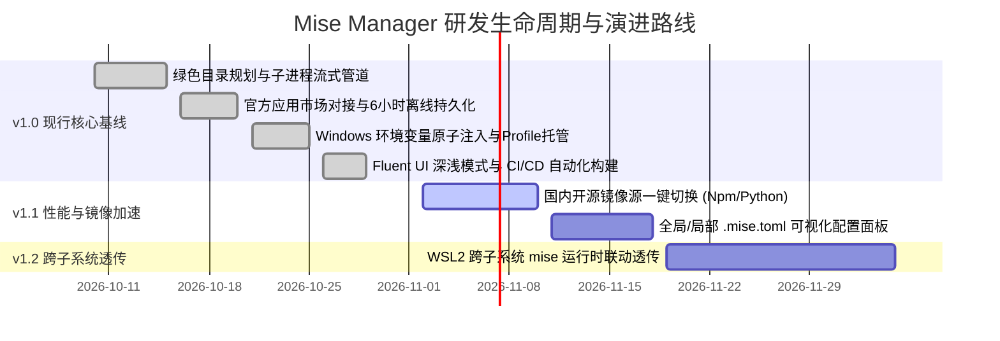

# 06 开发计划与任务分解（WBS）

| 项目 | 内容 |
| --- | --- |
| 产品名称 | Mise Manager — Windows 11 Fluent 风格 mise 版本管理器桌面应用 |
| 当前阶段 | v1.0 现行架构归档 / v1.1+ 升级演进规划 |
| 周期跨度 | 现行工程基线 ~ 后续功能迭代演进 |
| 负责团队 | 系统架构师 / Electron 核心工程师 / Windows 桌面开发工程师 |

---

## 1. 研发生命周期与里程碑规划 (Milestones)

---

## 2. WBS 任务分解结构（Work Breakdown Structure）

### 2.1 模块一：核心绿色主进程与进程管道 (`main.js`)
- [x] **1.1 绿色路径体系**：规划 `miseRootDir`、`miseExeDir`、`miseDataDir`、`miseBinDir` 映射模型；
- [x] **1.2 运行时状态感知**：实现基于文件修改时间戳与字节体积的毫秒级内存缓存机制；
- [x] **1.3 本地克隆与自动引导**：实现针对本地已知路径的克隆部署与官方在线安装兜底；
- [x] **1.4 进程树中断机制**：集成 Windows `taskkill /pid <PID> /f /t`，确保中止任务干净利落；
- [x] **1.5 外部程序安全唤起**：通过 `cmd.exe /c start` 与 `explorer.exe` 实现无延迟唤起。

### 2.2 模块二：官方应用生态市场 (`market`)
- [x] **2.1 官方 REST API 分页抓取**：实现针对 `mise-versions.jdx.dev` 的循环分页拉取与进度流式推送；
- [x] **2.2 本地离线持久化**：建立 `market_cache.json` 存储模型，支持 6 小时离线秒开；
- [x] **2.3 远端版本探查**：封装 `mise ls-remote <tool>` 倒序拉取版本号；
- [ ] **2.4 (升级项 v1.1) 国内镜像源加速**：提供一键为 Node、Python、Rust 注入国内镜像加速源机制。

### 2.3 模块三：已安装工具与版本管理 (`installed`)
- [x] **3.1 双轨扫描机制**：实现 `mise ls --json` 与 `installs/` 物理目录双轨并行兜底；
- [x] **3.2 多版本共存与聚合**：按工具名组织多物理版本列表；
- [x] **3.3 Global / Local 热激活**：封装 `mise use -g` 与 `mise use` 指令；
- [x] **3.4 物理目录快速定位**：实现指定版本安装路径的资源管理器一键唤起；
- [ ] **3.5 (升级项 v1.1) 配置文件可视化**：实现工作区 `.mise.toml` 与全局配置文件的可视化编辑器。

### 2.4 模块四：系统环境变量与 Profile 托管 (`env`)
- [x] **4.1 Base64 UTF-16LE 脚本通道**：构建无转义风险的 PowerShell 脚本执行网关；
- [x] **4.2 用户级 Path 原子写入**：安全拼接并前置 `bin` 与 `shims` 路径，自动清洗废弃老路径；
- [x] **4.3 环境变量还原与清理**：实现一键从 Windows 注册表中完全清除相关记录；
- [x] **4.4 PowerShell Profile 自动激活**：实现 PS 5.1 与 PS 7 Profile 的幂等注入并自动抑制 warning；
- [x] **4.5 Profile 纯净清除**：基于正则实现激活代码块的零残留移除。

### 2.5 模块五：UI 交互、打包与 CI/CD 自动化 (`build & release`)
- [x] **5.1 Fluent 视觉系统**：实现 Windows 11 Mica 半透明材质与自适应深浅色主题；
- [x] **5.2 零白屏启动**：窗口延迟呈现与安全兜底超时；
- [x] **5.3 GitHub 自动更新检测**：对接 Releases API，带 10 分钟防频控内存缓存；
- [x] **5.4 自动化截屏流水线**：开发 `yarn screenshot` 无头自动化脚本输出文档截图；
- [x] **5.5 多产物打包发布**：配置 GitHub Actions 输出 NSIS、Portable 与 Zip 绿色包。

---

## 3. 关键路径与依赖关系

1. **核心逻辑流**：
   `绿色目录规划` → `运行时探测与克隆` → `环境变量原子写入` → `市场/已安装数据就绪` → `Fluent UI 渲染`
2. **安全防护关键点**：
   - 环境变量注入仅针对当前用户的 `User` 范围，绝对避免因提权错误破坏 Windows 系统核心 PATH；
   - 保证应用在网络中断或 GitHub API 限流时具备 100% 的离线可用性。

---

## 4. 升级与技术演进路线 (Version Roadmap)

| 版本号 | 预期时间 | 核心特性与演进重点 |
| --- | --- | --- |
| **v1.0 (当前)** | 2026-10 | 绿色统一目录体系、官方市场离线缓存、双轨工具扫描、Win11环境变量托管、多渠道安装包 |
| **v1.1 (体验增强)** | 2026-11 | 国内镜像加速源一键注入、工作区 `.mise.toml` 可视化表单编辑器、全局参数高级微调 |
| **v1.2 (自动化插件)** | 2026-12 | 常用语言开发环境一键套件（如前端全家桶、Python AI全家桶）一键批量安装 |
| **v2.0 (全景联动)** | 2027-Q1 | WSL2 跨子系统环境互联互通、Docker 容器开发环境版本透传大盘 |
